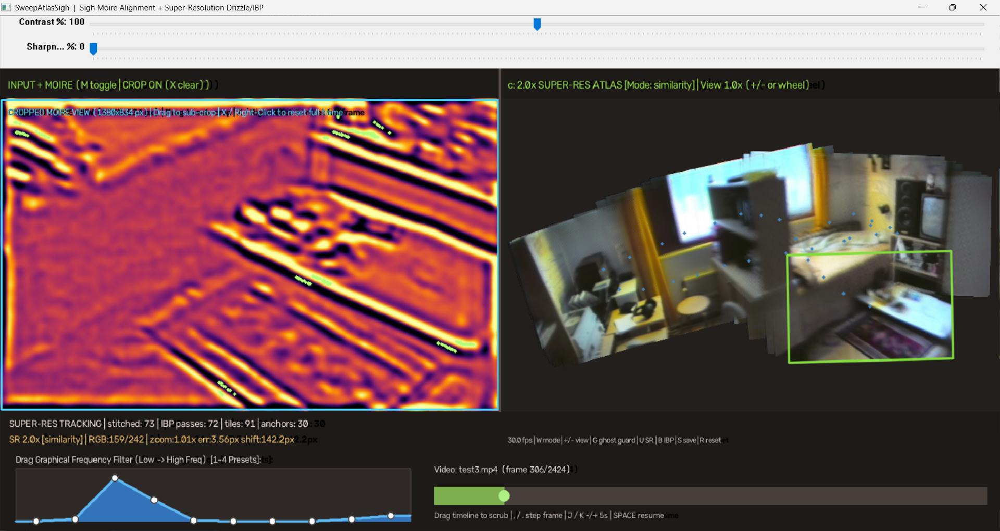

# VHSImageStitch

**Stitch overlapping frames from VHS recordings or ordinary videos into wider pictures.** A Windows app combining Sigh moiré edge matching with a 2× super-resolution atlas. No Python installation or GPU needed.



**[▶ Watch the VHSImageStitch video demonstration on YouTube](https://youtu.be/xhXtOVkcuMQ)** — shows the EXE, Python version, moiré frequency tuning, cropping, and image stitching.

## Download and run — Windows 10/11 (64-bit)

### **[Download VHSImageStitch.exe (64 MB)](https://github.com/anttiluode/VHSImageStitch/releases/download/v1.0.0/VHSImageStitch-Windows-x64.exe)**

**Save the EXE and double-click it. That's all you need to install or launch it.** It may take a moment to start the first time.

If you'd rather use a portable folder, [download the portable ZIP](https://github.com/anttiluode/VHSImageStitch/releases/download/v1.0.0/VHSImageStitch-Windows-x64-Portable.zip), extract it, and run `VHSImageStitch.exe` inside. Keep the `_internal` folder beside the EXE.

You can also find both files on the [v1.0.0 release page](https://github.com/anttiluode/VHSImageStitch/releases/tag/v1.0.0) under **Assets**. The automatically listed **Source code (zip)** is *not* the ready-to-run Windows program.

## Use it

1. **Double-click the EXE.** Press **O** and choose your VHS video (for example an MP4 or AVI).
2. **Press M** to see the orange/purple **Sigh moiré** view. **For VHS, keep this view visible while tuning:** drag the frequency graph at bottom left to emphasize stable **edges** (doors, walls, furniture, window frames) instead of noise. Try preset **3** (*Low-Mid Structural*) or roughly the curve in the screenshot.
3. **Let the video play** so overlapping frames build the mosaic on the right. Press **Space** to pause/resume.
4. **Press S** to save the stitched PNG in the `sweepatlas_output` folder (normally under the folder from which the EXE was started).

**M only changes what you see.** The program computes moiré features even in the normal camera view; the frequency graph affects the features used for matching.

Other handy keys: **1–4** = frequency presets; **+ / −** = zoom the atlas display; **G** = toggle a conservative ghosting guard; **L** = try relocalizing; **R** = reset the atlas; **Q** = quit. Drag over the left image to crop away VHS borders or timestamps (this resets the atlas).

**Limits:** slow, overlapping camera sweeps work best. Sideways motion in a 3D room can create double edges because objects at different distances shift differently. A 2× output grid does not guarantee twice the detail of the original VHS recording.

## Run the Python source instead

If you prefer Python, download the [source code](SweepAtlasSigh.py) or clone this repository. You need **Python 3.13** and just two third-party libraries: **NumPy** and **OpenCV**. Tkinter (used for the file picker) is included with standard Windows Python installations.

Open PowerShell in the downloaded project folder and install the libraries:

```powershell
py -3.13 -m pip install numpy opencv-python
```

Run the program with its webcam input:

```powershell
py -3.13 SweepAtlasSigh.py
```

Or load a saved VHS capture directly:

```powershell
py -3.13 SweepAtlasSigh.py --video "my_vhs_video.mp4"
```

You can also start without a filename and press **O** to pick a video. The same **M**, frequency-graph, and **S** controls work in the Python and EXE versions.

To check the alignment test or see more options:

```powershell
py -3.13 SweepAtlasSigh.py --self-test
py -3.13 SweepAtlasSigh.py --help
```

If the Windows Python launcher `py -3.13` is not available, use the command for your installed Python (for example `python3.13` or `python`) instead.

## Where the EXE comes from

The Windows EXE was **built from the public Python source in this repository**, using [GitHub Actions](https://github.com/anttiluode/VHSImageStitch/actions/workflows/windows-exe.yml) on a Windows x64 runner. The [build script](build-windows.ps1) packages [SweepAtlasSigh.py](SweepAtlasSigh.py) with PyInstaller, NumPy and OpenCV, and runs a synthetic registration self-test. The result was uploaded as a downloadable asset to the [v1.0.0 release](https://github.com/anttiluode/VHSImageStitch/releases/tag/v1.0.0).

Anyone can inspect the source and the build instructions. The EXE is **not digitally signed**, so Windows may show an unfamiliar-app warning. The build test is not a guarantee of compatibility with every Windows computer or VHS format.
